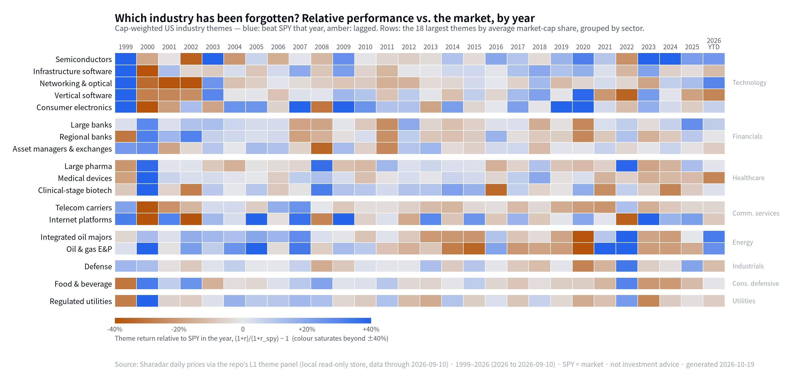

<div align="center">

<picture>
  <source media="(prefers-color-scheme: dark)" srcset="docs/images/brand/wordmark-dark.svg">
  
</picture>

# macro-sector-agent

**A top-down US equity research pipeline that asks not "what should I buy?" but "which industry is forgotten right now?"**

Finds forgotten themes, separates cyclical troughs from structural decay, and organizes stocks that survive hard exclusions alongside decision-ready context.

[](https://github.com/younghwan91/macro-sector-agent/actions/workflows/ci.yml)
[](https://www.python.org/)
[](LICENSE)
[](https://www.linkedin.com/in/younghwan-chae/)

[Guide](docs/guide.en.md) · [CLI Reference](docs/cli-reference.md) · [Daily Run](docs/18-daily-run.md) · [한국어](README.md)

</div>

<picture>
  <source media="(prefers-color-scheme: dark)" srcset="docs/images/hero-dark.png">
  
</picture>

<p align="center"><sub>Annual relative performance vs. market heatmap across 18 US industry themes (1999–2026)</sub></p>

## Getting Started

Requires Python 3.12+ and [uv](https://docs.astral.sh/uv/).

```bash
git clone https://github.com/younghwan91/macro-sector-agent && cd macro-sector-agent
make install                 # Install dependencies with uv sync
make check                   # Verify installation with ruff + mypy + pytest
uv run msa run daily         # Generate read-only candidate view in state/daily/<date>/
```

Running `msa run daily` writes theme rankings and stock shortlists to `state/daily/<date>/digest.md`. Scans and backtests run without API keys when a local DuckDB store is present, while `msa research` invokes the local `claude` CLI (`--provider claude_code`) by default.

## What It Does

| Stage | Role | Owner |
|---|---|---|
| **L0 Data** | Loads Sharadar and FRED data into a PIT DuckDB store | Code |
| **L1 Scoreboard** | Ranks 134 theme buckets by neglect and capital-cycle turn | Code |
| **L3 Value-Trap Screener** | Evaluates supply destruction and demand durability with 4 roles | LLM |
| **L4 · P1 Shortlist & Triage** | Applies runway, leverage, and maturity-wall exclusions, then orders reading | Code |
| **L5 · L6 Portfolio & Ops** | Computes weights, entry ladders, and stops for human picks, plus journaling | SOCP · Code |
| **Final Decision** | Selects tickers and chart entry timing from the shortlist | Human |

## Design Principles

- **Weights are never tuned by search.** Every constant lives with its rationale in `src/msa/basis.py`; parameter sweeps and grid searches are forbidden.
- **The LLM only screens themes.** Deterministic code handles stock filtering and ordering to keep fame bias out of shortlists.
- **No claims without sources or invalidations.** Schemas reject any thesis whose `evidence` or `invalidations` list is empty.

## Caveats

- **Not investment advice.** Outputs are measurements and explicit assumptions; a human makes and executes every trade.
- **No performance numbers are advertised.** Expected returns, win rates, and strategy CAGR or Sharpe appear neither here nor in reports.
- **Validated by pre-registration and prospective logs.** L1 and L4 use pre-registered backtests for predictive power, while L3 and L5 rely on the append-only `journal/` and rejection ledger.
- **External data and CLI requirements:** `SHARADAR_API_KEY` is only needed for L0 ingestion, and `research` exits with code 3 if the `claude` CLI is missing.

## Docs

| Doc | What's Inside |
|---|---|
| [Guide](docs/guide.en.md) | 20,931-ticker funnel, full architecture, sample output, run cadences |
| [Rules](docs/rules.md) | Full text of absolute rules §1–§8 and PIT conventions |
| [CLI Reference](docs/cli-reference.md) | `msa` subcommands, flags, artifact paths, exit codes |
| [Daily Run Guide](docs/18-daily-run.md) | Day-to-day operations and how to read the digest |
| [Validation Gates](docs/10-validation.md) | DSR/PBO backtest gates and prospective verification |
| [Basis Registry](docs/24-basis-registry.md) | Rationale for every declared threshold and weight |

## Contributing & Support

- **Bug reports and feature requests:** Open an issue on [GitHub Issues](https://github.com/younghwan91/macro-sector-agent/issues).
- **Author:** **Younghwan Chae** · [GitHub @younghwan91](https://github.com/younghwan91) · [LinkedIn](https://www.linkedin.com/in/younghwan-chae/)

## License

MIT — [LICENSE](LICENSE).
