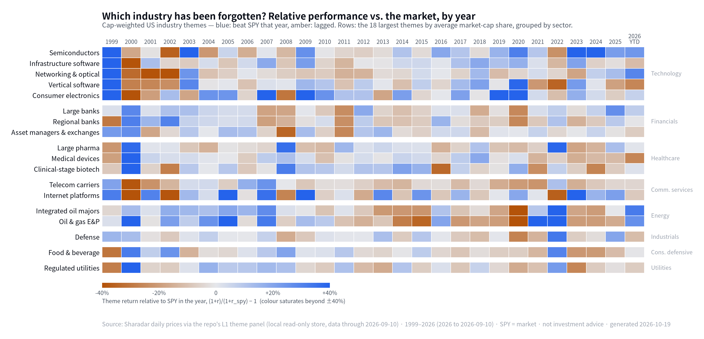
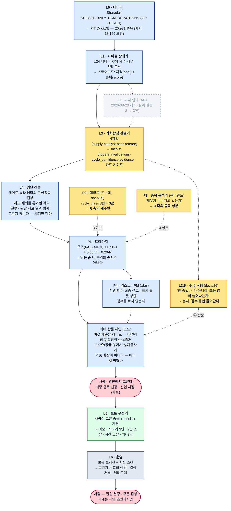

# macro-sector-agent

[](https://github.com/younghwan91/macro-sector-agent/actions/workflows/ci.yml)
[](https://www.python.org/)
[](LICENSE)
[](https://www.linkedin.com/in/younghwan-chae/)

**"뭘 사야 하나" 가 아니라 "지금 어느 산업이 잊혔나" 를 묻는 미국 주식 하향식 리서치 파이프라인.** 잊힌 테마를 찾고, 사이클 저점인지 구조적 사망인지를 가른 뒤, 그 테마 안에서 하드 제외를 통과한 종목 전부를 판단 재료와 함께 명단으로 내놓는다. 고르는 것은 사람이다.

<picture>
  <source media="(prefers-color-scheme: dark)" srcset="docs/images/hero-dark.png">
  
</picture>

- **위아래는 전부 결정론이고 LLM 은 판단 계층 중 L3 허리(가치함정 판별)에만 있다.** 뒤에 붙은 P2·P3·L3.5 는 새 축 없이 계수·논지로만 기여한다. 거기서도 증거만 따진다 — `evidence` 나 `invalidations` 가 비면 스키마가 저장을 거부한다.
- **기계는 고르지 않고 제외만 한다.** 런웨이 <4분기 · ND/EBITDA >6× · 만기벽 >0.5 를 하드 제외하고 남은 적격 종목 전부를 동일가중으로 싣는다 — 사전 등록 검정에서 어떤 선정 규칙도 이것을 이기지 못했다(`docs/15`, `journal/2026-08-24-l4-selection-retired.md`).
- **가중치는 탐색으로 정하지 않는다.** 판정을 만드는 상수는 전부 근거와 함께 `src/msa/basis.py` 한 곳에 있고(`msa ops why`), 검정이 "이 블록은 일하지 않는다" 고 해도 값은 두고 사실만 기록한다.

## 시작하기

Python ≥3.12 · [uv](https://docs.astral.sh/uv/). `SHARADAR_API_KEY` 는 L0 적재에만 필요하고 스토어가 이미 있으면 스캔·백테스트는 키 없이 돈다. L3 판별기(`msa research`)는 기본 `--provider claude_code`(로컬 `claude` CLI)라 별도 API 키가 없다.

```bash
git clone <이 저장소> && cd macro-sector-agent
make install                 # uv sync
make check                   # ruff + mypy + pytest — 설치 확인
uv run msa run daily         # 첫 실행 — 읽기 전용 후보 뷰. 산출물 state/daily/<date>/
```

`msa run daily` 한 번이 아래 §4 같은 다이제스트를 만든다. `research` 단계는 로컬 `claude` CLI 를 호출하므로 미설치면 제공자 오류(종료코드 3)로 끝난다. 명령 전체는 [`docs/cli-reference.md`](docs/cli-reference.md), 첫 운영 순서는 [`docs/18-daily-run.md`](docs/18-daily-run.md).

## 1. 무엇을 하나

| 단계 | 하는 일 | 누가 |
|---|---|---|
| **L0 데이터** | Sharadar SF1·SEP·DAILY·TICKERS·ACTIONS·SFP(+FRED) → PIT DuckDB. **20,931 종목, 폐지 18,169 포함** | 코드 |
| **L1 사이클 상태기** | 134 테마 버킷마다 `pool = mean(A 망각, B 베이스) ≥ 0.5` 로 자격을, `score = C 턴 · E 자본사이클 · F 펀더멘털` 로 순위를 낸다. 밸류(D)는 어느 점수에도 안 들어간다 | 코드 |
| **L3 가치함정 판별기** | 상위 K=8 테마만. 가르는 질문은 하나 — **공급이 파괴될 때 수요가 남아 있는가.** 5축(물량 추세·자본사이클·대체 위협·원가곡선·잔존 위험), 4역할(`supply`·`catalyst`·점수를 숨긴 `bear`·`referee`) → `passed / contested / rejected` | **LLM** |
| **L3.5 수급 균형** | "안 죽었나" 가 아니라 **"쓰는 양이 늘어나는가"** — 향후 3~5년 실물 수요 증가율 대 실물 공급 증가율. 논지에만 들어가고 점수에는 안 들어간다 | **LLM** |
| **L4 명단** | 게이트 통과 테마의 구성종목 전부에 하드 제외만 적용. 적격 전부를 시총·`ND/EBITDA`·런웨이·`52wH`·`RS`·레드플래그 열과 함께 싣는다. 행 사이에 서열이 없다 | 코드 |
| **P1 트리아지** | 구획(I-A 지금 볼 자리 · I-B 고점권 · II 판별 대기 · III 판별 전) 먼저, 구획 안에서만 `0.50·J + 0.30·C + 0.20·R`. **읽는 순서이지 수익률 순서가 아니다** | 코드 |
| **섹터 관문 체인** | ①잊혀짐 ②함정 아님 ③증거 ④수요/공급 ⑤거시 ⑥지금 자리 — 가중 합산이 아니라 순서 있는 관문. 산출은 "몇 점" 이 아니라 "어디서 막혔나" | 코드 |
| **사람** | 명단에서 최종 종목과 진입 시점을 차트로 정한다 | **사람** |
| **L5 포트 구성기** | 사람이 고른 종목 + thesis + 자본 → 비중 · 사다리 3단 · 논지 스탑(무효화 1건이면 전량 청산) · 자본 스탑 · 시간 스탑 | SOCP |
| **L6 운영** | 보유 포지션에 트리거·무효화 점검, append-only 결정 저널, 텔레그램 | 코드 |

**깔때기 — 20,931 종목이 테마당 명단이 되기까지** (2026-08-14 실행 당시 산출 — 스토어 기준일 2026-08-14, 저장 산출물 `state/scans/2026-08-14/meta.json`)

| 단계 | 숫자 | 출처 |
|---|---|---|
| 스캔 입력 → 테마 배정 | 19,717 → 134 버킷에 17,917 배정 · 미배정 141 · Shell 제외 1,659 · **미분류 시총 0.000%** (기준 <5%, 넘으면 스캔 중단) | `state/scans/2026-08-14/meta.json` |
| L1 자격 | 134 → **70** 테마. 나머지 64 는 관찰 목록(버린 것이 아니다) | `POOL_MIN = 0.5`, `src/msa/l1/scoreboard.py` |
| L1 순위 | 상위 **8** | `--top-k 8` 기본값 |
| L3 게이트 | `rejected` → 기각 대장 · `contested` → 관찰 목록. 둘 다 편입 불가 | `docs/04` |
| L4 (`commodity_chem`) | 구성 35 → 상장 16 → 하드 제외 8(런웨이 2 · ND/EBITDA 5 · 재무 없음 1) → **적격 8 = 명단 8행** (현 스토어 2026-09-10 으로 재실행하면 35→16→7→9 — 런웨이·부채는 오늘 스냅샷이라 달라진다) | `msa picks commodity_chem --asof 2026-08-14 --no-write` |
| 명단에서 몇 개를 사는가 | **정해져 있지 않다** — 열린 질문, 새 사전 등록이 필요하다 | `docs/06` §6.2 |

제외된 것은 매 단계 **수와 사유가 리포트에 남는다**(`CLAUDE.md` §2 조용한 절단 금지). 대용치가 결측이어도 자르지 않고 세어서 보고한다 — 은행·보험·REIT 는 `debtc` 미보고율이 98%+ 라 선언된 적 없는 대용치로 자르면 선언되지 않은 강제가 된다.

**명단에 올랐다는 것이 뜻하지 않는 것.** L3 는 비용 통제상 상위 K 테마에만 돌기 때문에 **134 테마 전부를 판정하는 경로는 설계상 없다.**

| 뜻하는 것 | 뜻하지 **않는** 것 |
|---|---|
| 테마가 L1 자격을 통과했고 상위 K 에 들었다 | 그 테마가 **함정이 아니라고 판정됐다** |
| 종목이 하드 제외(런웨이·레버리지·만기벽)를 통과했다 | 그 종목이 좋다 · 지금이 살 때다 |

논지 없는 테마는 명단 머리에 `논지: 논지 없음 — L3 미실행` 이 그대로 적히고, P1 의 구획이 그런 테마(III)를 판별 통과 테마(I) 위로 절대 올리지 않는다. `52wH` 열이 1급인 이유도 같다 — 테마가 돈다는 것과 그 안의 종목이 이미 돌았다는 것은 다른 말이다(같은 명단에서 **NFLX** −38%, **ROKU** +0%). 어느 쪽이 좋은 진입인지는 시스템이 답하지 않는다.

## 2. 왜 이렇게 만들었나

정본은 [`CLAUDE.md`](CLAUDE.md) 의 여덟 규칙이고, 근거와 사례는 [`docs/rules.md`](docs/rules.md).

- **탐색으로 가중치를 정하지 않는다.** 표본이 사실상 하나(1998~2026 미국 단일 경로)라 DSR·PBO 도 거기 맞춰 옮긴 가중치를 못 잡는다. 파라미터 스윕·그리드 서치 금지. 구조를 바꾸는 유일한 경로는 **결과를 보기 전에** 후보와 합격 기준을 문서로 고정하는 사전 등록(`docs/12`·`14`·`15`·`17`).
- **에이전트는 테마만 고른다. 종목은 코드가 고른다.** LLM 에게 종목 명단을 만들게 하면 유명세 편향이 들어온다.
- **출처 없는 주장과 무효화 조건 없는 논지는 저장되지 않는다.** LLM 의 기억은 증거가 아니다. 기각된 thesis 도 감사를 위해 저장한다.
- **백테스트할 수 없는 절반은 사전 반증가능성으로 묶는다.** 전향적 기록(`journal/`, append-only)과 확신도 캘리브레이션(Brier, `msa ops calibration`)이 검증하고, 기각 대장은 기각한 테마의 수익률을 분기마다 갱신한다 — 기각이 옳았는지도 검증 대상이다.
- **성과 수치를 광고하지 않는다.** 아래 표도 스코어의 예측력(rank-IC)이지 전략 수익률이 아니다.

| 계층 | 검정 | 결과 |
|---|---|---|
| L1 스코어보드 | 가능 | 복합 점수(S0/S1)는 A 망각이 C·E 가 번 것을 상쇄해 **FAIL** → `pool`+`score` 분리(S2) **PASS**(12M rank-IC +0.078 [+0.015, +0.145]). 이후 두 대안 구조 모두 현행을 못 이겨 유지. `docs/backtest-l1.md` |
| L4 종목 선정 | 가능 | `rank_score` **FAIL** · 축 단독은 부호 반대 · 하드 필터는 알파가 아니지만 사망률 차 CI 하한 > 0 — 그래서 선정 규칙을 버리고 하드 제외만 남겼다. `docs/backtest-l4.md`·`docs/15` |
| L3 축 3 · L5 사다리·스탑 | **불가** | 2015년의 정책·광산 폐쇄를 오늘의 지식 없이 재구성할 수 없고, 사다리·스탑은 경로 의존·표본 부족 |
| 전체 통합 수익률 | **정의되지 않는다** | 위가 불가인 이상 앞으로도 만들어지지 않는다 |

> 합격은 "한 경로에서 어긋나지 않았다" 이지 "맞았다" 가 아니다. 다음 검정에서 틀리면 값을 고치는 것이 아니라 기록한다.

## 3. 구조



파랑 = 코드가 판단한다(결정론·전수·소급 검정 가능) · 노랑 = LLM 이 판단한다(코드가 물리적으로 할 수 없는 수급·정책·대체 위협만) · 초록 = 최적화(판단이 아니라 예산 배분) · 분홍 = 사람. **L4 와 L5 사이에도 사람이 있다.**

LLM 은 좁은 허리(L3)에만 있다 — 위·아래가 결정론이라 싸고 재현 가능하고 유명세 편향이 안 들어온다. 나중에 붙은 P2·P3·L3.5 도 새 축을 만들지 않고 기존 축에 계수로 기여하거나(P2·P3) 점수에 아예 안 들어간다(L3.5). 분석 단위가 GICS 섹터가 아니라 **134 테마 버킷**(`state/themes.yaml`)인 이유는 같은 Basic Materials 안에 은·PGM·희토류·리튬처럼 드라이버가 전혀 다른 종목이 섞이기 때문이다. 각 필터의 정의는 `docs/02`(L1 6블록) · `docs/04`(L3 5축) · `docs/26`(L3.5) · `docs/06`(L4) · `docs/07`(L5) · [hedge-fund-evolution-design](docs/superpowers/specs/2026-08-29-hedge-fund-evolution-design.md)(P1 트리아지·관문 체인).

## 4. 실제 출력

아래 블록은 `msa run daily` 가 자동으로 다시 쓴다(손으로 고치지 않는다). 동결 연구 스토어 기준일 2026-09-10 의 실행 출력이다.

<!-- MSA:LATEST -->

## 오늘의 결론 · 2026-10-05

> **차트 확인 대상 32종목 — 편입 가능 `cement_aggregates` · `managed_care` · `shipping_container` · `specialty_chem` 의 명단 62 중**
>
> **`AMRZ` -38% · `BCC` -17% · `CRH` -33% · `CX` -21% · `EXP` -24% · `KNF` -39% · `LOMA` -23% · `MLM` -29%** 외 24종목. 그중 **레드플래그·감점이 붙은 것 9종목**. 나머지는 52주 고점 −15%(선언값) 이내라 지금 자리가 아니다. **여섯 관문을 다 통과한 섹터는 없다.** 가장 멀리 간 것은 `cement_aggregates` (③ 믿을 수 있나 관문에서 막혔다). 가장 많이 막은 곳은 **② 함정이 아닌가** (9개 테마) — 가치 함정 판별을 통과했나 (L3) ⚠ **상위 5 중 5개가 `specialty_chem` 한 테마다 (100%) — 사실상 한 베팅이다.** ⚠ **판정을 만든 근거 97건 중 18건은 원문에서 못 찾은 숫자가 있고 14건은 문서를 읽지 못했다.** 그중 **먼저 열 것 9건** — `cement_aggregates` [24] · [36] · [47] / `managed_care` [2] / `specialty_chem` [5] · [10] · [14] · [31] · [33]. URL 과 무엇을 찾을지는 `msa ops audit-evidence cement_aggregates` · `msa ops audit-evidence managed_care` · `msa ops audit-evidence specialty_chem` 가 적어 준다. (사람이 원문 대조를 끝낸 5건은 목록에서 뺐다.) 확인된 근거가 하나도 없는 축: capital_cycle, substitution, terminal_risk. **판정은 사람이 차트로 한다** — 시스템이 한 말은 '이 테마는 함정이 아니고 이 종목들은 재무가 버틴다' 까지다. ⚠ 는 레드플래그·감점이 붙은 종목이다.
>
> ⚠ **가격 스토어가 2026-09-10 에서 멈춰 있다 — 마지막 거래일보다 뒤처졌다.** 적재를 확인해라. 52주 고점 대비도 그 날짜 값이다.

<sub>`msa run daily` 가 자동으로 다시 쓴다. 스캔 기준일 **2026-09-10** · 가격 스토어 마지막 날 **2026-09-10** (거래일 22일 뒤처짐 — 미 거래일 기준이다. KST 달력 날짜와 다른 것은 정상이다). 성과 수치는 없다 — 측정값과 판정뿐이다 (`CLAUDE.md` §7).</sub>

| # | 테마 | 점수 | 판별 | 명단 | 플래그 |
|---:|---|---:|---|---:|---|
| 1 | `media_streaming` | 0.86 | 편입 불가 · 0.45 | 36 | SECULAR — 게이트 필요 |
| 2 | `health_it` | 0.80 | 편입 불가 · 0.45 | 41 | SECULAR — 게이트 필요 |
| 3 | `fertilizer_potash` | 0.74 | 편입 불가 · 0.45 | 10 | — |
| 4 | `staffing_consulting` | 0.72 | 편입 불가 · 0.35 | 44 | — |
| 5 | `telecom_carriers` | 0.70 | 편입 불가 · 0.45 | 36 | — |
| 6 | `asset_managers_exchanges` | 0.68 | 편입 불가 · 0.35 | 170 | — |
| 8 | `lumber_paper` | 0.67 | 편입 불가 · 0.35 | 8 | — |
| 9 | `it_services` | 0.66 | 편입 불가 · 0.45 | 56 | SECULAR — 게이트 필요 |

**눌린 종목** (순서 = triage(읽는 순서) — 수익률 순서가 아니다)

**52주 고점 대비**

```
FSI       -47%  ██████████████▍
ALTO      -34%  ██████████▎
HWKN      -33%  ██████████
LWLG      -72%  █████████████████████▊
ESI       -30%  █████████▎
WDFC      -25%  ███████▌
PRM       -19%  █████▉
ODC       -19%  █████▊
BGLC      -75%  ██████████████████████▉
NTIC      -20%  ██████▏
CMT       -16%  █████
DD        -17%  █████▏
CBT       -15%  ████▋
TGLS      -47%  ██████████████▍
MATV      -16%  ████▊
SMID      -44%  █████████████▍
KNF       -39%  ███████████▉
AMRZ      -38%  ███████████▍
ALHC      -48%  ██████████████▋
CNEY      -79%  ████████████████████████
CRH       -33%  █████████▉
MLM       -29%  ████████▊
YMAT      -78%  ███████████████████████▌
RMIX      -44%  █████████████▎
EXP       -24%  ███████▎
VMC       -24%  ███████▎
USLM      -17%  █████▏
MOH       -18%  █████▍
TTAM      -24%  ███████▍
BCC       -17%  █████▏
LOMA      -23%  ███████
CX        -21%  ██████▌
```

<sub>막대는 크기만 — 부호는 숫자가 든다. 순서는 triage 이지 낙폭 순이 아니다.</sub>

| 종목 | 테마 | 52wH | 가격 | ADV20 | 비고 |
|---|---|---:|---:|---:|---|
| ⚠ `FSI` | `specialty_chem` | -47% | $5.70 | $98.7K | interest_coverage_lt1 |
| `ALTO` | `specialty_chem` | -34% | $3.96 | $6.0M | — |
| `HWKN` | `specialty_chem` | -33% | $123 | $19.1M | — |
| ⚠ `LWLG` | `specialty_chem` | -72% | $5.16 | $15.1M | consecutive_operating_loss |
| `ESI` | `specialty_chem` | -30% | $34.17 | $169.0M | — |
| `WDFC` | `specialty_chem` | -25% | $199 | $20.4M | — |
| ⚠ `PRM` | `specialty_chem` | -19% | $30.54 | $31.6M | interest_coverage_lt1 |
| `ODC` | `specialty_chem` | -19% | $86.20 | $9.6M | — |
| ⚠ `BGLC` | `specialty_chem` | -75% | $1.48 | $13.9K | consecutive_operating_loss;zombie_streak |
| `NTIC` | `specialty_chem` | -20% | $7.90 | $42.8K | — |
| `CMT` | `specialty_chem` | -16% | $23.68 | $587.0K | — |
| `DD` | `specialty_chem` | -17% | $127 | $160.7M | — |
| `CBT` | `specialty_chem` | -15% | $78.79 | $26.3M | — |
| `TGLS` | `cement_aggregates` | -47% | $38.31 | $9.7M | — |
| ⚠ `MATV` | `specialty_chem` | -16% | $12.33 | $6.5M | zombie_streak |
| `SMID` | `cement_aggregates` | -44% | $24.23 | $424.7K | — |
| `KNF` | `cement_aggregates` | -39% | $57.18 | $51.5M | — |
| `AMRZ` | `cement_aggregates` | -38% | $40.44 | $181.1M | — |
| `ALHC` | `managed_care` | -48% | $12.76 | $55.4M | — |
| ⚠ `CNEY` | `specialty_chem` | -79% | $0.54 | $37.4K | dilution_gt15 |
| `CRH` | `cement_aggregates` | -33% | $87.66 | $397.5M | — |
| `MLM` | `cement_aggregates` | -29% | $502 | $340.9M | — |
| ⚠ `YMAT` | `specialty_chem` | -78% | $2.09 | $4.2M | full_capital_impairment |
| ⚠ `RMIX` | `cement_aggregates` | -44% | $13.96 | $7.1M | consecutive_operating_loss |
| `EXP` | `cement_aggregates` | -24% | $184 | $68.2M | — |
| `VMC` | `cement_aggregates` | -24% | $251 | $243.0M | — |
| `USLM` | `cement_aggregates` | -17% | $116 | $15.6M | — |
| ⚠ `MOH` | `managed_care` | -18% | $200 | $116.6M | interest_coverage_lt1 |
| `TTAM` | `cement_aggregates` | -24% | $14.68 | $3.8M | — |
| `BCC` | `cement_aggregates` | -17% | $75.05 | $19.7M | — |
| `LOMA` | `cement_aggregates` | -23% | $10.09 | $3.8M | — |
| `CX` | `cement_aggregates` | -21% | $10.66 | $58.1M | — |

<sub>상위 8개만 싣는다. 전문·제외 사유·판단 재료 열은 `state/daily/2026-10-05/digest.md`. **순위가 높다 = 오래 잊혀졌다** 이지 사라는 뜻이 아니다 — 판별(`msa research`)을 거치지 않은 테마는 후보가 아니다.</sub>

<!-- /MSA:LATEST -->

## 5. 쓰는 법

이 저장소는 데이터를 적재하지 않는다 — `Store` 는 DuckDB 를 읽기 전용으로 연다. 환경변수는 `SHARADAR_API_KEY`(L0 적재에만) · `FRED_API_KEY`(없으면 L1 축 1 실물 참조가 `data_missing` 으로 표시되고 중단하지 않는다) · `MSA_TELEGRAM_TOKEN`·`MSA_TELEGRAM_CHAT_ID`(둘 다 있고 `--send` 일 때만 배달).

```bash
uv run msa run daily         # 일간 — 읽기 전용 후보 뷰
uv run msa run weekly        # 주간 점검: 전수 스캔 + msa check --weekly
uv run msa run monthly       # 월간 (의사결정 주기). 끝은 제안·초안, 집행은 사람
```

| | 단계 | 판별(L3)이 어디서 도는가 |
|---|---|---|
| `msa run daily` | `scan · select · picks · diff · check · digest · research · audit · triage · readme` | `research` 는 다이제스트 뒤에 오고 **편입 가능이 하나 나오면 멈춘다.** 그래서 다이제스트의 테마 대부분은 여전히 논지가 없다 |
| `msa run monthly` | `scan · select · research · ingest · picks · assemble · portfolio · report` | 상위 K=8 테마에 판정이 생긴다. 기본 `--provider none` 은 호출하지 않고 사람 논지·직전 thesis 를 찾기만 한다 |

**결정 케이던스는 월간이다.** 일간은 후보 뷰이고 거기서 고르는 것은 사람이다. `msa research` 는 한 번에 하나씩 돌린다(동시 실행은 속도 제한으로 죽는다).

**실패 시 동작** — 적재 실패·커버리지 감사 실패(미분류 시총 ≥ 5%)는 스캔 중단(부분 데이터로 점수를 내지 않는다) · 스키마 검증 실패는 해당 테마 제외 + 사유 기록 · 최적화 infeasible 은 완화 순서 고정 C3(집중도) → C1(MDD), MDD 는 마지막까지 지킨다. `msa research` 종료코드 2 = 스키마 거부(저장 안 함), 3 = 제공자 오류(재시도).

```bash
make check       # ruff + mypy(strict) + pytest (data·net 제외, ~40초)
make test-all    # data·net 포함 — 실제 DuckDB 스토어·FRED 키 필요
```

## 6. 문서 지도

**계층 정의** — [00](docs/00-overview.md) 문제 정의·비목표 · [01](docs/01-theme-universe.md) 134 버킷·`cycle_class` · [02](docs/02-cycle-state.md) L1 6블록 · [04](docs/04-value-trap.md) 가치함정 판별기 · [05](docs/05-agent-research.md) L3 계약·bear 격리 · [06](docs/06-stock-selection.md) L4 · [07](docs/07-portfolio.md) L5 · [08](docs/08-data-contract.md) 데이터 계약 · [09](docs/09-operations.md) 케이던스·저널·배달 · [10](docs/10-validation.md) 무엇을 재고 무엇을 못 재는가 · [18](docs/18-daily-run.md) 실전 운영 · [24](docs/24-basis-registry.md) 왜 그 값인가 · [cli-reference](docs/cli-reference.md) 명령 전체.

**검정 판정문** — [backtest-l1](docs/backtest-l1.md) · [backtest-l4](docs/backtest-l4.md) · [16](docs/16-module-audit-2026-08-24.md) 모듈 감사(`vcp_base` 결함 #P2 — 명단의 `VCP*` 표기는 알려진 결함을 표시한 채로 싣는 것이다).

**사전 등록된 설계 질문** `docs/12`~`docs/27`, **결정 저널** `journal/`(append-only — 무엇을 언제 왜 정했는지).

**가져온 코드** — `portfolio-research`(Sharadar 어댑터·DuckDB PIT 스토어) · `momentum`(Minervini Stage·VCP·RS Rating) · `fin-checkup`(재무 레드플래그·텔레그램)을 `src/msa/vendor` 에 복사(vendoring)했다. 릴리스 주기가 다른 저장소를 git 의존으로 묶지 않기 위해서다.

## 면책

**투자 조언이 아니다.** 이 저장소는 측정값과 명시된 가정을 산출할 뿐이며 집행은 사람이 한다. 자동 주문 기능은 만들지 않는다. 기대수익률·승률·수익 배수는 이 문서에도 리포트에도 쓰지 않는다 (`CLAUDE.md` §7·§8).

## 기여 및 이슈 제보

- 🐛 버그 제보, 질문, 기능 제안: [GitHub Issues](https://github.com/younghwan91/macro-sector-agent/issues)
- 📈 업데이트 소식: [팔로우 @younghwan91](https://github.com/younghwan91)


## 관련 프로젝트 — 오픈소스 퀀트 스택

한국·미국 주식과 암호화폐를 아우르는 오픈소스 스택입니다. 각 저장소는 독립적으로 쓸 수 있습니다.

| 축 | 프로젝트 | 설명 |
|---|---|---|
| 🇰🇷 한국 주식 | **[kiwoom-client](https://github.com/younghwan91/kiwoom-client)** | 키움증권 REST API Python 라이브러리 — 국내주식 엔드포인트 전수·실시간 WebSocket, sync + async (`pip install kiwoom-client`) |
| 🇰🇷 한국 주식 | **[krx-fundamentals-client](https://github.com/younghwan91/krx-fundamentals-client)** | 국내 기업 펀더멘탈 Python 클라이언트 라이브러리 — 재무제표·투자지표·배당·종목 스크리닝 (DART + KRX + 네이버) |
| 🇰🇷 한국 주식 | **[krx-news-client](https://github.com/younghwan91/krx-news-client)** | 한국 주식 뉴스·공시를 한 스키마로 내주는 Python 클라이언트 라이브러리 (DART + 토스증권) |
| 🇰🇷 한국 주식 | **[krx-quant-core](https://github.com/younghwan91/krx-quant-core)** | 한국 주식 퀀트 시스템 공통 Python 코어 — KRX 호가·가격제한폭·세션 규칙, 시행일별 거래세 비용모델, 키움 주문 가드, DART 중대공시 위험 분류, 체결 시뮬레이션, Deflated Sharpe·purged CV 통계 |
| 🇰🇷 한국 주식 | **[fin-checkup](https://github.com/younghwan91/fin-checkup)** | 관심종목 위험 공시 텔레그램 알림 + DART·SEC 재무 건강검진 — 측정값과 사실만 전달한다 |
| 🇰🇷 한국 주식 | **[quant-airflow](https://github.com/younghwan91/quant-airflow)** | 시세·수급·실적을 TimescaleDB 로 수집하는 Airflow 파이프라인 — 상장폐지 종목까지 담아 생존편향을 막는다 |
| 🇰🇷 한국 주식 | **[swing-it](https://github.com/younghwan91/swing-it)** | 코스피·코스닥 알파 심사 프레임워크 — 개별 트레이드 분포로 판정하고 랜덤 음성대조·purged CV·Deflated Sharpe 를 CI 가드레일로 강제 |
| 🇺🇸 미국 주식 | **[portfolio-research](https://github.com/younghwan91/portfolio-research)** | 미국주식 팩터 엔진 — point-in-time·생존편향 보정 데이터 위에서 walk-forward 를 Deflated Sharpe·PBO 로 게이팅하고 ETF 전술배분도 같은 관문을 지난다 |
| 🇺🇸 미국 주식 | **[automated-stock-trading-systems](https://github.com/younghwan91/automated-stock-trading-systems)** | Bensdorp 의 7개 비상관 트레이딩 시스템 백테스터 (교육용 재구현) |
| ₿ 암호화폐 | **[binance-quant-engine](https://github.com/younghwan91/binance-quant-engine)** | 암호화폐 선물 백테스트·실행 엔진 — 룩어헤드 0, 백테스트↔실거래 일체화 |
| ₿ 암호화폐 | **[crypto-quant-insights](https://github.com/younghwan91/crypto-quant-insights)** | 실거래 선물 시스템을 검증하며 나온 차트 연구 노트 — 폭락 스트레스 테스트·Kelly 레버리지·체결 간극 |

## 만든 사람

**채영환 (Younghwan Chae)** · [GitHub @younghwan91](https://github.com/younghwan91) · [LinkedIn](https://www.linkedin.com/in/younghwan-chae/)

전체 오픈소스 퀀트 스택은 [프로필](https://github.com/younghwan91)에서 한눈에 볼 수 있습니다.
