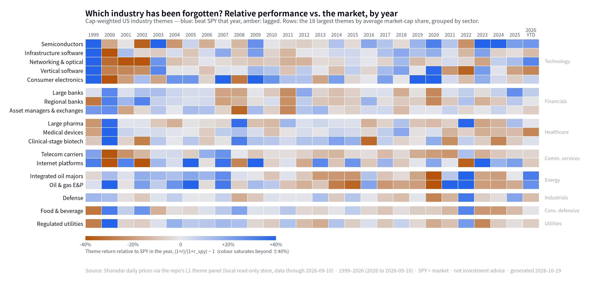

<div align="center">

<picture>
  <source media="(prefers-color-scheme: dark)" srcset="docs/images/brand/wordmark-dark.svg">
  
</picture>

# macro-sector-agent

**"뭘 사야 하나"가 아니라 "지금 어느 산업이 잊혔나"를 묻는 미국 주식 하향식 리서치 파이프라인**

잊힌 테마를 찾고 사이클 저점과 구조적 쇠퇴를 가른 뒤, 하드 제외를 통과한 종목을 판단 재료와 함께 정리합니다.

[](https://github.com/younghwan91/macro-sector-agent/actions/workflows/ci.yml)
[](https://www.python.org/)
[](LICENSE)
[](https://www.linkedin.com/in/younghwan-chae/)

[가이드](docs/guide.md) · [명령어](docs/cli-reference.md) · [일일 운영](docs/18-daily-run.md) · [English](README.en.md)

</div>

<picture>
  <source media="(prefers-color-scheme: dark)" srcset="docs/images/hero-dark.png">
  
</picture>

<p align="center"><sub>미국 산업 테마 18개의 연도별 시장 대비 상대성과 히트맵 (1999–2026)</sub></p>

## 시작하기

Python 3.12 이상과 [uv](https://docs.astral.sh/uv/)가 필요합니다.

```bash
git clone https://github.com/younghwan91/macro-sector-agent && cd macro-sector-agent
make install                 # uv sync로 의존성 설치
make check                   # ruff + mypy + pytest로 설치 확인
uv run msa run daily         # 읽기 전용 후보 뷰 생성 (state/daily/<date>/)
```

`msa run daily`를 실행하면 `state/daily/<date>/digest.md`에 테마 순위와 종목 명단이 생성됩니다. 스캔과 백테스트는 로컬 DuckDB 스토어만 있으면 API 키 없이 실행되며, `msa research`는 기본값인 로컬 `claude` CLI(`--provider claude_code`)를 호출합니다.

## 하는 일

| 단계 | 역할 | 주체 |
|---|---|---|
| **L0 데이터** | Sharadar와 FRED 데이터를 PIT DuckDB로 적재합니다 | 코드 |
| **L1 스코어보드** | 134개 테마 버킷을 망각도와 자본사이클 기준으로 순위화합니다 | 코드 |
| **L3 가치함정 판별** | 상위 테마의 공급 파괴와 수요 지속성을 4개 역할로 검증합니다 | LLM |
| **L4 · P1 명단과 트리아지** | 런웨이·부채·만기벽 하드 제외 후 읽기 순서를 정리합니다 | 코드 |
| **L5 · L6 포트폴리오와 운영** | 사람이 고른 종목의 비중·사다리·스탑을 계산하고 저널을 기록합니다 | SOCP · 코드 |
| **최종 판단** | 명단에서 종목과 진입 시점을 차트로 결정합니다 | 사람 |

## 설계 원칙

- **가중치를 탐색으로 정하지 않습니다.** 모든 상수는 근거와 함께 `src/msa/basis.py`에 선언하며, 파라미터 스윕이나 그리드 서치를 금지합니다.
- **LLM은 테마 판별에만 참여합니다.** 종목 명단 생성에서 유명세 편향을 없애기 위해 종목 필터링과 정렬은 결정론적 코드가 맡습니다.
- **출처와 무효화 조건이 없으면 저장하지 않습니다.** `evidence`나 `invalidations`가 비어 있는 논지는 스키마 단계에서 거부합니다.

## 사용 시 주의사항

- **투자 조언이 아닙니다.** 산출물은 측정값과 명시된 가정일 뿐이며, 매매 판단과 집행은 사람이 직접 합니다.
- **성과 수치를 광고하지 않습니다.** 기대수익률, 승률, 전략 CAGR이나 Sharpe는 문서와 리포트에 싣지 않습니다.
- **사전 등록과 전향적 기록으로 검증합니다.** L1·L4는 사전 등록 백테스트로 예측력을 확인하고, L3·L5는 append-only `journal/`과 기각 대장으로 사후 검증합니다.
- **외부 데이터와 CLI 조건:** `SHARADAR_API_KEY`는 L0 적재에만 필요하며, `claude` CLI가 없으면 `research` 단계는 종료코드 3으로 끝납니다.

## 문서

| 문서 | 내용 |
|---|---|
| [가이드](docs/guide.md) | 20,931종목 깔때기, 전체 아키텍처, 출력 예시, 실행 케이던스 |
| [규칙 전문](docs/rules.md) | 절대 규칙 §1–§8 및 PIT 규약 상세 근거 |
| [명령어 레퍼런스](docs/cli-reference.md) | `msa` 하위 명령, 옵션, 산출물 경로, 종료코드 |
| [일일 운영 가이드](docs/18-daily-run.md) | 실전 운영 순서와 다이제스트 해석 방법 |
| [검증 관문](docs/10-validation.md) | DSR·PBO 백테스트 관문과 전향적 검증 기준 |
| [상수 근거 레지스트리](docs/24-basis-registry.md) | 코드에 선언된 임계값과 가중치의 근거 목록 |

## 기여 및 문의

- **버그 제보 및 제안:** [GitHub Issues](https://github.com/younghwan91/macro-sector-agent/issues)에 남겨 주세요.
- **만든 사람:** **채영환 (Younghwan Chae)** · [GitHub @younghwan91](https://github.com/younghwan91) · [LinkedIn](https://www.linkedin.com/in/younghwan-chae/)

## 라이선스

MIT — [LICENSE](LICENSE).
