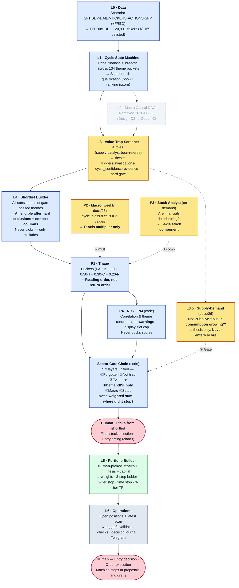

# macro-sector-agent Guide

New here? Start with the [README](../README.en.md).

<!-- toc -->
- [1. What It Does](#1-what-it-does)
- [2. Why It Was Built This Way](#2-why-it-was-built-this-way)
- [3. Architecture](#3-architecture)
- [4. Sample Output](#4-sample-output)
- [Today's Summary · 2026-10-05](#todays-summary--2026-10-05)
- [5. Usage](#5-usage)
- [6. Documentation Map](#6-documentation-map)
<!-- /toc -->

## 1. What It Does

| Stage | What It Does | Who |
|---|---|---|
| **L0 Data** | Sharadar SF1·SEP·DAILY·TICKERS·ACTIONS·SFP (+FRED) → PIT DuckDB. **20,931 tickers, including 18,169 delisted** | Code |
| **L1 Cycle State Machine** | Across 134 theme buckets, qualifies via `pool = mean(A Forgotten, B Base) ≥ 0.5` and ranks via `score = C Turn · E CapCycle · F Fundamentals`. Valuation (D) enters no score | Code |
| **L3 Value-Trap Screener** | Top K=8 themes only. One dividing question — **when supply is destroyed, does demand remain?** 5 axes (volume trend, cap cycle, substitution threat, cost curve, terminal risk), 4 roles (`supply`, `catalyst`, score-blind `bear`, `referee`) → `passed / contested / rejected` | **LLM** |
| **L3.5 Supply-Demand Balance** | Not "is it alive?" but **"is physical consumption growing?"** — 3–5yr physical demand growth vs. supply growth. Enters thesis only, never the score | **LLM** |
| **L4 Shortlist** | Applies only hard exclusions to all constituents of gate-passed themes. Lists all eligible stocks with mcap, `ND/EBITDA`, runway, `52wH`, `RS`, and red-flag columns. No ranking between rows | Code |
| **P1 Triage** | Buckets first (I-A act-now zone, I-B near highs, II awaiting verdict, III unscreened), then `0.50·J + 0.30·C + 0.20·R` within each bucket. **Reading order, not expected-return order** | Code |
| **Sector Gate Chain** | ①Forgotten ②Not a trap ③Evidence ④Demand/Supply ⑤Macro ⑥Current setup — sequential gates, not weighted sum. Output is "where did it stop?", not "what score?" | Code |
| **Human** | Picks final stocks and entry timing from the shortlist using charts | **Human** |
| **L5 Portfolio Builder** | Human-selected stocks + thesis + capital → weights, 3-step entry ladder, thesis stop (full exit on 1 invalidation), capital stop, time stop | SOCP |
| **L6 Operations** | Checks triggers/invalidations on open positions, append-only decision journal, Telegram | Code |

**Funnel — how 20,931 tickers narrow to a per-theme shortlist** (from the 2026-08-14 run — store as-of 2026-08-14, per scan artifact `meta.json` — `state/scans/` is not in the repo and is generated on scan)

| Stage | Count | Source |
|---|---|---|
| Scan input → theme assignment | 19,717 → 17,917 assigned to 134 buckets · 141 unassigned · 1,659 Shells excluded · **Unclassified mcap 0.000%** (threshold <5%, aborts scan if exceeded) | Scan `meta.json` |
| L1 Qualification | 134 → **70** themes. Remaining 64 go to watchlist (not discarded) | `POOL_MIN = 0.5`, `src/msa/l1/scoreboard.py` |
| L1 Ranking | Top **8** | `--top-k 8` default |
| L3 Gate | `rejected` → rejection ledger · `contested` → watchlist. Neither eligible for entry | `docs/04` |
| L4 (`commodity_chem`) | 35 constituents → 16 listed → 8 hard-excluded (2 runway · 5 ND/EBITDA · 1 no financials) → **8 eligible = 8 shortlist rows** (re-running on 2026-09-10 store gives 35→16→7→9 because runway/debt use current snapshot) | `msa picks commodity_chem --asof 2026-08-14 --no-write` |
| How many to buy from shortlist | **Unspecified** — open question requiring a new pre-registration | `docs/06` §6.2 |

At every stage, **excluded counts and reasons are recorded in the report** (`CLAUDE.md` §2: no silent truncation). Missing proxies are counted and reported rather than dropped — banks, insurers, and REITs have 98%+ missing `debtc`, so substituting an undeclared proxy would create an undeclared force.

**What appearing on the shortlist does NOT mean.** Because L3 only runs on the top K themes for cost control, **there is by design no path that screens all 134 themes.**

| What it means | What it does **NOT** mean |
|---|---|
| The theme passed L1 qualification and made top K | The theme was **judged not to be a value trap** |
| The stock passed hard exclusions (runway, leverage, maturity wall) | The stock is good · now is the time to buy |

Themes without a thesis explicitly print `논지: 논지 없음 — L3 미실행` (No thesis — L3 not run) at the top of their shortlist, and P1 triage buckets never rank unscreened themes (III) above passed themes (I). That is also why `52wH` is a first-class column — a theme turning does not mean every stock in it hasn't already run (in the same shortlist, **NFLX** −38% vs. **ROKU** +0%). Which is the better entry is left to the human.

## 2. Why It Was Built This Way

The canonical source is the eight rules in [`CLAUDE.md`](../CLAUDE.md), with rationale and cases in [`docs/rules.md`](rules.md).

- **No weight tuning by search.** With effectively one historical sample (1998–2026 US single path), even DSR/PBO cannot catch weights overfitted to it. Parameter sweeps and grid searches are forbidden. The only path to structural change is pre-registration (`docs/12`, `14`, `15`, `17`), locking candidates and pass criteria in writing **before looking at results**.
- **The agent only picks themes; code picks stocks.** Letting an LLM build stock lists introduces fame bias.
- **Claims without sources and theses without invalidation conditions are not saved.** LLM memory is not evidence. Rejected theses are also saved for audit.
- **The untestable half is bound by prospective falsifiability.** Forward-only records (`journal/`, append-only) and confidence calibration (Brier, `msa ops calibration`) track accuracy, while the rejection ledger updates quarterly returns on rejected themes — checking whether rejections were right too.
- **No performance numbers are advertised.** The table below reports score predictive power (rank-IC), not strategy returns.

| Layer | Testable? | Result |
|---|---|---|
| L1 Scoreboard | Yes | Composite score (S0/S1) **FAIL** (A Forgotten offset gains from C/E) → split `pool`+`score` (S2) **PASS** (12M rank-IC +0.078 [+0.015, +0.145]). Two subsequent alternatives failed to beat S2, so S2 stays. `docs/backtest-l1.md` |
| L4 Stock Selection | Yes | `rank_score` **FAIL** · single axes had wrong signs · hard filters aren't alpha, but mortality-rate diff CI lower bound > 0 — so selection rules were retired and only hard exclusions remain. `docs/backtest-l4.md`, `docs/15` |
| L3 Axis 3 · L5 Ladder/Stops | **No** | 2015 policy/mine closures cannot be reconstructed without hindsight, and ladders/stops are path-dependent with too few samples |
| End-to-End Portfolio Return | **Undefined** | As long as the above is untestable, no composite return will be fabricated |

> Passing means "not falsified on one path," not "proven right." If a future test fails, the failure is recorded rather than tweaking numbers.

## 3. Architecture



Blue = judged by code (deterministic, exhaustive, backtestable) · Yellow = judged by LLM (only supply/demand, policy, and substitution threats that code physically cannot assess) · Green = optimization (budget allocation, not judgment) · Pink = human. **A human sits between L4 and L5 as well.**

The LLM only sits in the narrow L3 waist — because everything above and below is deterministic, it stays cheap, reproducible, and free of fame bias. Later additions P2, P3, and L3.5 do not create new axes; they either contribute multipliers to existing axes (P2, P3) or stay out of scoring altogether (L3.5). Analysis uses **134 theme buckets** (`state/themes.yaml`) rather than GICS sectors because Basic Materials lumps together silver, PGMs, rare earths, and lithium despite completely different drivers. Filter definitions: `docs/02` (L1 6 blocks) · `docs/04` (L3 5 axes) · `docs/26` (L3.5) · `docs/06` (L4) · `docs/07` (L5) · [hedge-fund-evolution-design](superpowers/specs/2026-08-29-hedge-fund-evolution-design.md) (P1 triage & gate chain).

## 4. Sample Output

The block below is automatically rewritten by `msa run daily` (do not edit by hand). Output from running on the frozen research store as-of 2026-09-10.

<!-- MSA:LATEST -->

## Today's Summary · 2026-10-05

> **32 stocks to chart-check — out of 62 shortlisted across eligible `cement_aggregates`, `managed_care`, `shipping_container`, and `specialty_chem`**
>
> **`AMRZ` -38% · `BCC` -17% · `CRH` -33% · `CX` -21% · `EXP` -24% · `KNF` -39% · `LOMA` -23% · `MLM` -29%** plus 24 others (including **9 with red flags/penalties**). The rest are within −15% (declared threshold) of their 52-week high and not in an actionable setup. **No sector cleared all six gates.** Furthest was `cement_aggregates` (stopped at gate ③ Evidence). Most blocked at **② Not a value trap** (9 themes) — L3 screening. ⚠ **5 of the top 5 are in one theme: `specialty_chem` (100%) — effectively one bet.** ⚠ **Of 97 evidence items behind verdicts, 18 have numbers not found in source text and 14 could not be read.** **9 to open first**: `cement_aggregates` [24] · [36] · [47] / `managed_care` [2] / `specialty_chem` [5] · [10] · [14] · [31] · [33]. URLs and what to verify are listed by `msa ops audit-evidence cement_aggregates` · `msa ops audit-evidence managed_care` · `msa ops audit-evidence specialty_chem` (5 human-verified items removed). Axes with zero verified evidence: capital_cycle, substitution, terminal_risk. **The human decides on the chart** — the system only states that these themes are not traps and these stocks' financials hold up. ⚠ marks stocks with red flags or penalties.
>
> ⚠ **Price store stopped at 2026-09-10 — lagging behind the last trading day.** Check ingestion. 52wH drawdowns are also as of that date.

<sub>Auto-rewritten by `msa run daily`. Scan as-of **2026-09-10** · Price store last date **2026-09-10** (22 trading days behind — US trading days, differing from KST calendar date is normal). No performance metrics — measurements and verdicts only (`CLAUDE.md` §7).</sub>

| # | Theme | Score | Verdict | Shortlist | Flags |
|---:|---|---:|---|---:|---|
| 1 | `media_streaming` | 0.86 | Ineligible · 0.45 | 36 | SECULAR — gate required |
| 2 | `health_it` | 0.80 | Ineligible · 0.45 | 41 | SECULAR — gate required |
| 3 | `fertilizer_potash` | 0.74 | Ineligible · 0.45 | 10 | — |
| 4 | `staffing_consulting` | 0.72 | Ineligible · 0.35 | 44 | — |
| 5 | `telecom_carriers` | 0.70 | Ineligible · 0.45 | 36 | — |
| 6 | `asset_managers_exchanges` | 0.68 | Ineligible · 0.35 | 170 | — |
| 8 | `lumber_paper` | 0.67 | Ineligible · 0.35 | 8 | — |
| 9 | `it_services` | 0.66 | Ineligible · 0.45 | 56 | SECULAR — gate required |

**Pulled-back stocks** (order = triage reading order, not return order)

**Drawdown from 52-week high**

```
FSI       -47%  ██████████████▍
ALTO      -34%  ██████████▎
HWKN      -33%  ██████████
LWLG      -72%  █████████████████████▊
ESI       -30%  █████████▎
WDFC      -25%  ███████▌
PRM       -19%  █████▉
ODC       -19%  █████▊
BGLC      -75%  ██████████████████████▉
NTIC      -20%  ██████▏
CMT       -16%  █████
DD        -17%  █████▏
CBT       -15%  ████▋
TGLS      -47%  ██████████████▍
MATV      -16%  ████▊
SMID      -44%  █████████████▍
KNF       -39%  ███████████▉
AMRZ      -38%  ███████████▍
ALHC      -48%  ██████████████▋
CNEY      -79%  ████████████████████████
CRH       -33%  █████████▉
MLM       -29%  ████████▊
YMAT      -78%  ███████████████████████▌
RMIX      -44%  █████████████▎
EXP       -24%  ███████▎
VMC       -24%  ███████▎
USLM      -17%  █████▏
MOH       -18%  █████▍
TTAM      -24%  ███████▍
BCC       -17%  █████▏
LOMA      -23%  ███████
CX        -21%  ██████▌
```

<sub>Bars show magnitude only — sign is in the number. Ordered by triage, not drawdown.</sub>

| Ticker | Theme | 52wH | Price | ADV20 | Notes |
|---|---|---:|---:|---:|---|
| ⚠ `FSI` | `specialty_chem` | -47% | $5.70 | $98.7K | interest_coverage_lt1 |
| `ALTO` | `specialty_chem` | -34% | $3.96 | $6.0M | — |
| `HWKN` | `specialty_chem` | -33% | $123 | $19.1M | — |
| ⚠ `LWLG` | `specialty_chem` | -72% | $5.16 | $15.1M | consecutive_operating_loss |
| `ESI` | `specialty_chem` | -30% | $34.17 | $169.0M | — |
| `WDFC` | `specialty_chem` | -25% | $199 | $20.4M | — |
| ⚠ `PRM` | `specialty_chem` | -19% | $30.54 | $31.6M | interest_coverage_lt1 |
| `ODC` | `specialty_chem` | -19% | $86.20 | $9.6M | — |
| ⚠ `BGLC` | `specialty_chem` | -75% | $1.48 | $13.9K | consecutive_operating_loss;zombie_streak |
| `NTIC` | `specialty_chem` | -20% | $7.90 | $42.8K | — |
| `CMT` | `specialty_chem` | -16% | $23.68 | $587.0K | — |
| `DD` | `specialty_chem` | -17% | $127 | $160.7M | — |
| `CBT` | `specialty_chem` | -15% | $78.79 | $26.3M | — |
| `TGLS` | `cement_aggregates` | -47% | $38.31 | $9.7M | — |
| ⚠ `MATV` | `specialty_chem` | -16% | $12.33 | $6.5M | zombie_streak |
| `SMID` | `cement_aggregates` | -44% | $24.23 | $424.7K | — |
| `KNF` | `cement_aggregates` | -39% | $57.18 | $51.5M | — |
| `AMRZ` | `cement_aggregates` | -38% | $40.44 | $181.1M | — |
| `ALHC` | `managed_care` | -48% | $12.76 | $55.4M | — |
| ⚠ `CNEY` | `specialty_chem` | -79% | $0.54 | $37.4K | dilution_gt15 |
| `CRH` | `cement_aggregates` | -33% | $87.66 | $397.5M | — |
| `MLM` | `cement_aggregates` | -29% | $502 | $340.9M | — |
| ⚠ `YMAT` | `specialty_chem` | -78% | $2.09 | $4.2M | full_capital_impairment |
| ⚠ `RMIX` | `cement_aggregates` | -44% | $13.96 | $7.1M | consecutive_operating_loss |
| `EXP` | `cement_aggregates` | -24% | $184 | $68.2M | — |
| `VMC` | `cement_aggregates` | -24% | $251 | $243.0M | — |
| `USLM` | `cement_aggregates` | -17% | $116 | $15.6M | — |
| ⚠ `MOH` | `managed_care` | -18% | $200 | $116.6M | interest_coverage_lt1 |
| `TTAM` | `cement_aggregates` | -24% | $14.68 | $3.8M | — |
| `BCC` | `cement_aggregates` | -17% | $75.05 | $19.7M | — |
| `LOMA` | `cement_aggregates` | -23% | $10.09 | $3.8M | — |
| `CX` | `cement_aggregates` | -21% | $10.66 | $58.1M | — |

<sub>Top 8 only. Full text, exclusion reasons, and context columns are in `state/daily/2026-10-05/digest.md`. **Higher rank = longer forgotten**, not a buy recommendation — themes that have not passed `msa research` are not candidates.</sub>

<!-- /MSA:LATEST -->

## 5. Usage

This repo does not ingest data — `Store` opens DuckDB read-only. Environment variables: `SHARADAR_API_KEY` (L0 ingestion only), `FRED_API_KEY` (if unset, L1 Axis 1 physical references are marked `data_missing` without aborting), `MSA_TELEGRAM_TOKEN` and `MSA_TELEGRAM_CHAT_ID` (delivery only when both are set and `--send` is passed).

```bash
uv run msa run daily         # Daily — read-only candidate view
uv run msa run weekly        # Weekly check: full scan + msa check --weekly
uv run msa run monthly       # Monthly (decision cadence). Ends in proposals/drafts; human executes
```

| | Steps | Where L3 screening runs |
|---|---|---|
| `msa run daily` | `scan · select · picks · diff · check · digest · research · audit · triage · readme` | `research` runs after the digest and **stops as soon as one theme passes**, so most themes in the digest still have no thesis |
| `msa run monthly` | `scan · select · research · ingest · picks · assemble · portfolio · report` | Verdicts are generated for the top K=8 themes. Default `--provider none` does not invoke an LLM and only looks up human/prior theses |

**Decision cadence is monthly.** Daily runs are a candidate view from which a human selects. Run `msa research` one at a time (concurrent runs hit rate limits).

**Failure behavior** — Ingestion failure or coverage-audit failure (unclassified mcap ≥ 5%) aborts the scan (never scores partial data); schema validation failure excludes that theme and logs the reason; optimization infeasibility relaxes in fixed order C3 (concentration) → C1 (MDD), keeping MDD protected until last. `msa research` exit code 2 = schema rejected (not saved), 3 = provider error (retry).

```bash
make check       # ruff + mypy(strict) + pytest (excludes data/net, ~40s)
make test-all    # includes data/net — requires real DuckDB store and FRED key
```

## 6. Documentation Map

**Layer specs** — [00](00-overview.md) Problem & non-goals · [01](01-theme-universe.md) 134 buckets & `cycle_class` · [02](02-cycle-state.md) L1 6 blocks · [04](04-value-trap.md) Value-trap screener · [05](05-agent-research.md) L3 contract & bear isolation · [06](06-stock-selection.md) L4 · [07](07-portfolio.md) L5 · [08](08-data-contract.md) Data contract · [09](09-operations.md) Cadence, journal, delivery · [10](10-validation.md) What can & cannot be measured · [18](18-daily-run.md) Daily operations · [24](24-basis-registry.md) Why those constants · [cli-reference](cli-reference.md) Full CLI.

**Validation verdicts** — [backtest-l1](backtest-l1.md) · [backtest-l4](backtest-l4.md) · [16](16-module-audit-2026-08-24.md) Module audit (`vcp_base` defect #P2 — `VCP*` in the shortlist flags the known defect).

**Pre-registered design questions** `docs/12`–`docs/27`, **Decision journal** `journal/` (append-only — what was decided, when, and why).

**Vendored code** — `portfolio-research` (Sharadar adapter & DuckDB PIT store), `momentum` (Minervini Stage, VCP, RS Rating), and `fin-checkup` (financial red flags & Telegram) are vendored under `src/msa/vendor` to avoid coupling repos with different release cadences via git dependencies.
